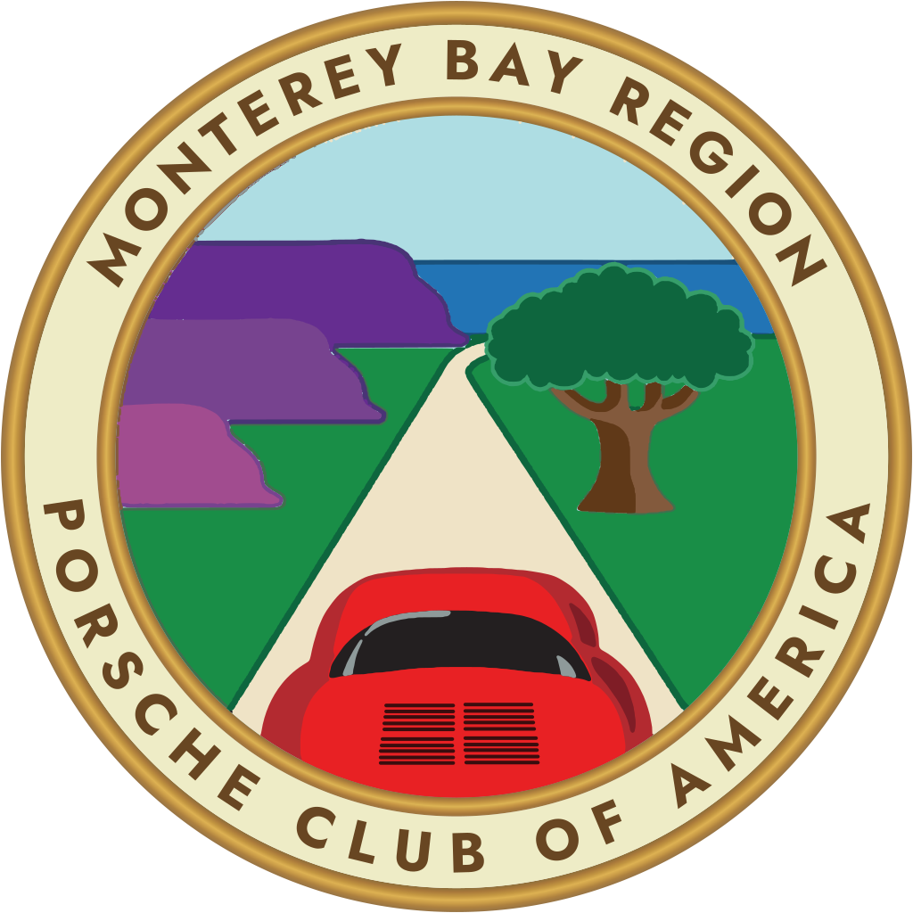
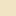

# PCA Monterey Bay Region: Official Logo

<p align="center"></p>

The official logo of the **Monterey Bay Region, Porsche Club of America**, approved unanimously by the Board of Directors on **October 26, 2026**.

**Download page:** [pca.carmelvalleytechnologies.com](https://pca.carmelvalleytechnologies.com/)

Read the **[Usage Guide (PDF)](logo/MBR-PCA-Logo-Usage-Guide.pdf)** for colors, minimum sizes, clear space and what not to do.

**Download everything:** [ZIP of all files](https://github.com/chriscoyoli/pca/archive/refs/heads/main.zip)

---

## Which file do I need?

| You are... | Send or use | Format |
|---|---|---|
| A printer, sign shop or enamel badge maker | [Full color](logo/pdf/mbr-pca-logo_full-color.pdf) or [Flat color](logo/pdf/mbr-pca-logo_flat-color.pdf) | PDF, [SVG](logo/svg/), [EPS](logo/eps/) (vector) |
| An embroidery digitizer (patches, shirts) | [Embroidery version](logo/pdf/mbr-pca-logo_embroidery.pdf) | PDF or [SVG](logo/svg/mbr-pca-logo_embroidery.svg) |
| Updating the website, an email or slides | [Full color PNG, 1024 px](logo/png/mbr-pca-logo_full-color_1024px.png) | PNG, transparent background |
| Using Word or a tool without transparency | [Full color JPG](logo/jpg/mbr-pca-logo_full-color_2048px_white-background.jpg) | JPG, white background |
| Setting the website icon | [favicon folder](logo/favicon/) | ICO and PNG |

## Versions

| Version | Best for |
|---|---|
| **Full color** | Primary logo, with metallic gold rings |
| **Flat color** | Solid spot colors: enamel badges, screen printing, vinyl |
| **Embroidery** | Fewer colors and no fine lines: patches and apparel |
| **Full color, MIRRORED** | Inside-glass window decals, **only if the printer asks for pre-mirrored art** |

Each version comes as SVG, PDF and EPS (vector, any size) plus PNG at several sizes.

## Folders

```
logo/
  MBR-PCA-Logo-Usage-Guide.pdf
  svg/       vector, best for web and most design tools
  pdf/       vector, best for printers and vendors (opens in Adobe Illustrator)
  eps/       vector, for older sign and print software
  png/       transparent background, 256 to 4096 px
  jpg/       white background
  favicon/   website icons
  source/    build scripts and the approved proof, to regenerate the files
```

## Official colors

| | Color | HEX | RGB |
|---|---|---|---|
|  | Gold rings | `#DBB04E` | 219, 176, 78 |
|  | Ivory band | `#EEECC6` | 238, 236, 198 |
|  | Lettering | `#684622` | 104, 70, 34 |
|  | Sky | `#AEDDE3` | 174, 221, 227 |
|  | Monterey Bay | `#2274B5` | 34, 116, 181 |
|  | Ridge, back | `#652D90` | 101, 45, 144 |
|  | Ridge, middle | `#77438F` | 119, 67, 143 |
|  | Ridge, front | `#A14C8F` | 161, 76, 143 |
|  | Grass | `#198E47` | 25, 142, 71 |
|  | Live oak | `#0E663E` | 14, 102, 62 |
|  | Oak trunk | `#603918` | 96, 57, 24 |
|  | Road | `#EFE3C6` | 239, 227, 198 |
|  | 356, Guards Red | `#E82124` | 232, 33, 36 |

For paint and enamel, match the 356 to Porsche Guards Red (paint code 80K) on a physical proof. CMYK starting values are in the usage guide.

## Use and permissions

This is the Monterey Bay Region's own logo. As noted at the October 26, 2026 board meeting, the region may use its authorized PCA and Monterey Bay Region logos but must not use artwork outside the permissions already granted. Vendors may use these files only to produce approved region items.

Please do not stretch, recolor, crop, retype or add effects to the logo, and do not add Porsche AG marks such as the Porsche crest or script. These files replace all earlier versions, including the old window sticker, the "P C A" version, and any image marked EXAMPLE.

## About the artwork

The logo depicts a red Porsche 356 (the only Porsche model available when the region was founded in the early 1960s) driving toward a California live oak, with the Carmel Valley and Big Sur ridgeline and Monterey Bay beyond.

The files were rebuilt as true vector artwork from the board-approved design: geometric rings, lettering set on arcs and converted to outlines (no fonts needed), and the scene traced into clean layered shapes. The lettering is set in [Jost](https://github.com/indestructible-type/Jost) Bold, licensed under the SIL Open Font License. See [`logo/source`](logo/source/) to regenerate the files.

Questions: Chris Coyoli, chris@coyoli.com
